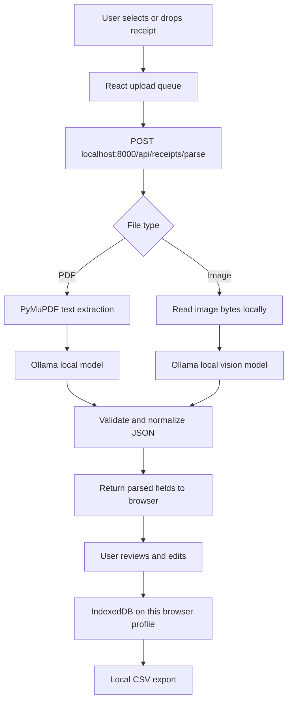

# ReceiptFlow AI — Architecture

## Goals and boundaries
ReceiptFlow AI favors local processing, transparent data flow, and human review. It is not an accounting system, tax adviser, or guarantee of correct extraction. Model output is untrusted until reviewed.

## High-level flow



## Privacy guarantees and assumptions
- The frontend is designed to call a loopback API (`127.0.0.1`) and has no cloud storage integration.
- The backend uses Ollama's local HTTP endpoint; it does not call a hosted LLM provider.
- IndexedDB stores expense metadata in the current browser profile. Browser storage is not a substitute for full-disk encryption.
- Files are processed in memory/temp request handling and are not intentionally persisted by the backend.
- There is no telemetry or account login in this implementation.
- Privacy depends on the runtime environment: Ollama must be local, the configured base URL must remain local, and the machine must be trusted. Avoid exposing ports, installing untrusted models, or using remote Ollama URLs.
- A browser extension, OS malware, backups, or a compromised local account could still access data.

## Component hierarchy

```text
App
├── Sidebar
├── TopBar
├── Dashboard
│   ├── MetricCards
│   ├── UploadDropzone
│   ├── ProcessingQueue
│   └── ExpenseTable
│       ├── SearchAndFilters
│       ├── ExpenseRow
│       └── EditExpenseDialog
├── PrivacyStatus
└── Toast / Error feedback
```

### Frontend responsibilities
- Validate extensions and file size before upload.
- Display queue states and API/model errors.
- Call FastAPI with `FormData`; never send documents to analytics.
- Require user review before treating model results as authoritative.
- Persist records in IndexedDB via `idb`.
- Build CSV locally from selected/filtered records.
- Support delete and edit operations locally.

## FastAPI-to-Ollama pipeline
1. **Input validation:** extension and byte-size checks; the API only accepts PDF and common raster images.
2. **Extraction:** PDFs use PyMuPDF to extract embedded text. Images use base64 data with the configured local vision model.
3. **Prompting:** ask the model to return a single JSON object with vendor, date, currency, subtotal, tax, total, category, and line items.
4. **Normalization:** strip JSON fences if present, parse JSON, coerce numbers, apply safe defaults, and validate the response using Pydantic.
5. **Response:** return structured data with a generated ID and no file path.
6. **Persistence:** the backend does not persist receipt records. The browser stores metadata only after the user receives and reviews the result.

## API
- `GET /api/health` — reports API and local Ollama reachability/model configuration.
- `POST /api/receipts/parse` — multipart upload; returns structured fields.
- `GET /` — API welcome message.

## Failure behavior
- If Ollama is offline, the endpoint returns a clear 503 error.
- If PDF text is empty, the API explains that scanned PDFs need OCR; it does not silently claim success.
- If model output is malformed, the API returns a 502 parsing error.
- If the model omits fields, safe defaults are returned, and the user can edit them.

## Threat model / production hardening
- Bind only to loopback.
- Keep CORS origins narrow.
- Add request rate/size limits and content sniffing if the app is later used by multiple local users.
- Consider malware scanning for untrusted uploads and OCR timeouts.
- Never log document contents or prompt bodies.
- Add automated tests for malicious PDFs, huge images, malformed model responses, and CSV formula injection.
- Before production accounting use, validate totals against line items and require explicit human confirmation.
