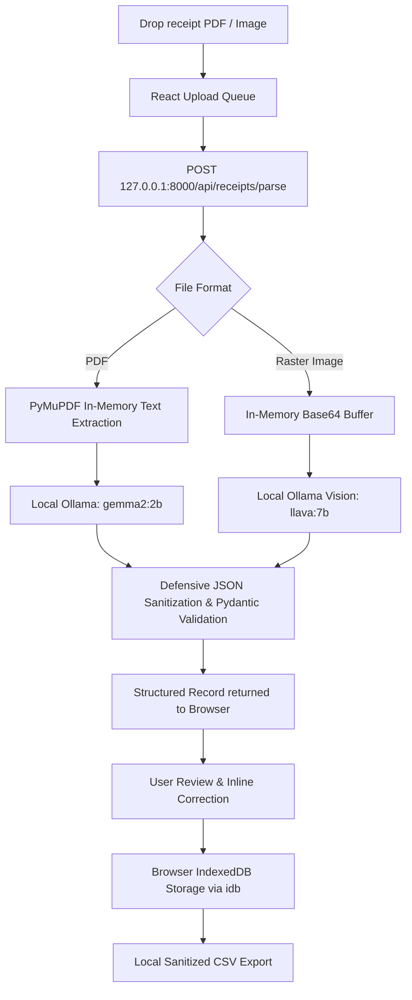

# ReceiptFlow AI: The Zero-Cloud, Local-First Receipt Sorter for Freelancers

*This is a submission for the [Hacktoberfest Open-Source AI Challenge Week 2: Side Hustle](https://dev.to/challenges/hacktoberfest-week2-2026-10-12)*

---

## What I Built

Every tax season or quarterly review, I found myself facing the same chaotic chore: a desktop folder cluttered with scattered PDF invoices, train ticket receipts, cloud subscription receipts, and equipment purchases. 

When I looked for tools to automate this, I ran into two big dealbreakers:
1. **Predatory SaaS Pricing:** Mainstream tools like Expensify, QuickBooks, or Dext charge $15 to $35 every single month just to scan basic receipts. As an independent builder, paying $200–$400 a year for simple OCR felt absurd.
2. **Privacy Dealbreakers:** Uploading my receipts to cloud services meant transmitting sensitive banking details, client names, home addresses, and confidential project costs to remote servers and proprietary LLM APIs.

I built **ReceiptFlow AI** to solve my own problem first—and package it as a clean, viable side-hustle product that other freelancers and indie builders would gladly pay for.

**ReceiptFlow AI** is a **100% local, privacy-first receipt and invoice organizer**. Documents are parsed on-device using open-weight models powered by **Ollama** (`gemma2:2b` for embedded text and `llava:7b` for images). The frontend keeps all metadata inside the browser's **IndexedDB**, and clean CSV exports are generated client-side.

No cloud databases. No monthly API bills. Zero documents ever leave the machine.

---

### Who Would Pay For It?

- **Freelancers & Consultants bound by NDAs:** Anyone working under non-disclosure agreements who cannot legally or ethically feed client-related expense documents into public cloud LLMs.
- **Indie Builders with Subscription Fatigue:** People tired of monthly recurring charges for basic utilities. Packaging this as a $29–$49 one-time purchase or desktop application offers huge value while costing me $0 in ongoing server/API overhead.
- **Frequent Travelers & Digital Nomads:** Anyone who needs to process travel receipts on trains, flights, or places with spotty internet connectivity.

---

## Demo

Here is the high-level data flow of how ReceiptFlow AI operates completely offline:



### Highlights of the User Experience:
- **Instant Engine Telemetry:** Real-time indicator displaying local Ollama reachability and active model (`LOCAL ENGINE ONLINE` / `ENGINE OFFLINE`).
- **Drag-and-Drop Batch Processing:** Drop multiple files (PDF, PNG, JPG, JPEG, WEBP) simultaneously with live processing queue indicators.
- **Smart Analytics:** Real-time expense totals, calculated tax breakdowns, and animated SVG sparklines.
- **Review & Inline Correction:** A clean modal editor to verify and fine-tune model outputs before committing them to records.
- **Formula-Injection Safe CSV Export:** Exports compliant CSV files with automated protection against spreadsheet formula injection (`=`, `@`, `+`, `-`).

---

## Code

The complete codebase is open source and available on GitHub:



**Repository:** [https://github.com/Babin123456/ReceiptFlow_AI](https://github.com/Babin123456/ReceiptFlow_AI)

---

## How I Built It

I designed ReceiptFlow AI around open-source AI and local runtime primitives:

### 1. Open-Source AI Core (Ollama + Open-Weight Models)
- **Text Extraction & Parsing:** For PDFs containing embedded digital text, `PyMuPDF` extracts the raw characters in memory. I feed this text to Google's **Gemma 2 2B** (`gemma2:2b`) running locally in Ollama. It is fast, lightweight, and runs smoothly on consumer laptops without needing high-end GPUs.
- **Vision Recognition:** For photo receipts and scanned receipts, image bytes are encoded into base64 and processed locally by **LLaVA 7B** (`llava:7b`).
- **Structured JSON Prompting:** The prompt instructs the model to act as a strict invoice data extraction engine, returning only a single JSON object with standardized keys (`vendor`, `invoice_number`, `date`, `currency`, `category`, `subtotal`, `tax`, `total`, `line_items`, `notes`).

### 2. Backend Service (FastAPI + Pydantic v2)
- Built with **Python 3.11** and **FastAPI**, bound strictly to loopback (`127.0.0.1`).
- **Defensive Extraction:** Strips Markdown fences (` ```json `), isolates the JSON body with regex, and validates data through Pydantic models with defensive defaults.
- **Stateless by Design:** The backend never saves files to disk or writes to a database. It processes files strictly in-memory and returns structured JSON immediately.

```python
# In backend/app/main.py
@app.post("/api/receipts/parse", response_model=ReceiptResult)
async def parse_receipt(file: UploadFile = File(...)):
    # Validates mime types, reads bytes into memory, sends to local Ollama
    # Never persists files to cloud or disk
```

### 3. Frontend Dashboard (React + TypeScript + Tailwind CSS)
- **Client Persistence with `idb`:** Uses browser IndexedDB to persist receipts across sessions without needing a remote backend database.
- **Framer Motion:** Delivers smooth micro-interactions, modal transitions, and dynamic state feedback.
- **Tailwind CSS & Lucide Icons:** Modern obsidian dark aesthetic tailored with mint green and violet accents.

---

## Why Does Open Innovation Matter?

Open-source AI was not just an implementation detail for ReceiptFlow AI—**it was the only way this product could work**.

1. **True Privacy Without Trusting "The Cloud":** Closed AI APIs (OpenAI, Anthropic, Google Cloud) require transmitting private financial documents over the wire. Even with zero-retention policies, regulated freelancers and privacy-conscious builders cannot take that risk. Running an open-weight model locally guarantees that data never leaves the laptop.
2. **Zero Marginal Inference Cost:** If I built this side hustle on top of closed APIs, every receipt processed would burn API credits ($0.01 to $0.05). A sudden influx of users or bulk uploads would destroy profitability. With open-weight models, my marginal cost per inference is literally $0.00. This makes a one-time purchase or open-core monetization model sustainable.
3. **Total Model Independence:** I am never at the mercy of sudden API deprecations, rate limits, or vendor price hikes. If a newer, faster model comes out, switching requires changing just one environment variable in `.env`.
4. **Offline Resilience:** I can process and organize my expenses on a train, on a flight, or in a coffee shop with spotty Wi-Fi.

---

## My Agent Session

Pairing with an AI agent during this build helped me move from idea to production-quality implementation fast:
- Architected the zero-persistence pipeline and local-first data flow.
- Engineered defensive prompt validation to prevent JSON parsing crashes when models return markdown fences or comments.
- Styled responsive layouts, Lucide icon integrations, and custom SVG sparklines.
- Implemented RFC 4180 compliant CSV export with formula injection sanitization.
- Orchestrated atomic Git commits with clear, human-like commit tracking across the entire codebase.
