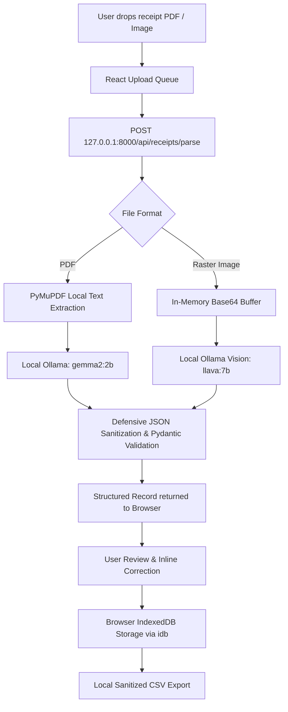

# ReceiptFlow AI: The Zero-Cloud, Local-First Receipt Sorter for Freelancers

*This is a submission for the [Hacktoberfest Open-Source AI Challenge Week 2: Side Hustle](https://dev.to/challenges/hacktoberfest-week2-2026-10-12)*

---

## What I Built

Every freelancer knows the dread of quarterly taxes: a desktop folder overflowing with random PDFs, crumpled coffee shop receipts, train ticket screenshots, and software subscription invoices. 

Existing solutions force a painful compromise:
1. **Expensive SaaS subscriptions:** Mainstream tools like Expensify, Dext, or QuickBooks charge $15 to $35 every month just to scan basic receipts.
2. **Cloud privacy risks:** Handing over invoices means sending client names, bank details, home addresses, and confidential contract expenses to remote third-party cloud servers and proprietary LLM APIs.

**ReceiptFlow AI** solves both problems. It is a **100% local, privacy-first receipt and invoice organizer** designed for freelancers, solopreneurs, and independent consultants. 

Documents are parsed directly on your laptop using open-weight models powered by **Ollama** (`gemma2:2b` for embedded text and `llava:7b` for multimodal images). The frontend stores all metadata client-side in the browser's **IndexedDB**, and CSV exports are generated entirely on-device.

No cloud accounts. No subscriptions. No tracking. Zero data leaves your machine.

---

### Who Would Pay For It?

- **Freelancers & Consultants with strict NDAs:** Professionals working with enterprise clients cannot legally or ethically feed client-related expense documents into public cloud LLMs.
- **Solopreneurs with subscription fatigue:** Small operators tired of paying $300+/year for simple OCR receipt scanning. A $29–$49 one-time desktop license is an instant no-brainer investment.
- **Digital Nomads & Frequent Travelers:** Anyone needing to record travel expenses while on planes, trains, or areas with spotty connectivity.

---

## Demo

Here is the high-level data flow illustrating the zero-cloud architecture:



### Key Highlights of the Experience:
- **Instant Engine Telemetry:** Real-time indicator displaying local Ollama reachability and the active open-weight model.
- **Drag-and-Drop Batch Processing:** Drag multiple files (PDF, PNG, JPG, JPEG, WEBP) simultaneously with live status indicators.
- **Smart Analytics:** Real-time expense aggregation, calculated tax breakdowns, and animated SVG sparklines.
- **Review & Inline Correction:** A modal editor to verify model outputs before committing them to records.
- **Formula-Injection Safe CSV Export:** Exports compliant CSV files with automated protection against spreadsheet formula injection (`=`, `@`, `+`, `-`).

---

## Code

The complete source code is open source and available on GitHub:



**Repository:** [https://github.com/Babin123456/ReceiptFlow_AI](https://github.com/Babin123456/ReceiptFlow_AI)

---

## How I Built It

ReceiptFlow AI is built from the ground up around open-source AI and local runtime primitives:

### 1. Open-Source AI Core (Ollama + Open-Weight Models)
- **Text Extraction & Parsing:** When a PDF contains digital text, `PyMuPDF` extracts the embedded characters in memory. We then feed the text into Google's **Gemma 2 2B** (`gemma2:2b`) running via Ollama. It is fast, lightweight, and runs comfortably on consumer laptops without demanding high-end GPUs.
- **Vision Recognition:** For scanned tickets or photos of physical receipts, image bytes are encoded to base64 and processed locally by **LLaVA 7B** (`llava:7b`).
- **Structured JSON Prompting:** We instruct the model to return a single deterministic JSON object with standardized keys (`vendor`, `invoice_number`, `date`, `currency`, `category`, `subtotal`, `tax`, `total`, `line_items`, `notes`).

### 2. Backend Service (FastAPI + Pydantic v2)
- Built with **Python 3.11** and **FastAPI**, bound strictly to loopback (`127.0.0.1`).
- **Defensive Extraction:** Strips Markdown fences (` ```json `), extracts raw JSON using regex boundaries, and validates through Pydantic models with sensible fallbacks.
- **Stateless by Design:** The backend never saves files to disk or writes to a database. It processes files in-memory and returns structured JSON immediately.

```python
# In backend/app/main.py
@app.post("/api/receipts/parse", response_model=ReceiptResult)
async def parse_receipt(file: UploadFile = File(...)):
    # Validates mime types, reads bytes into memory, sends to local Ollama
    # Never persists files to cloud or disk
```

### 3. Frontend Dashboard (React + TypeScript + Tailwind CSS)
- **Local Persistence with `idb`:** Utilizes browser IndexedDB to persist receipts across sessions without sending data to any cloud database.
- **Framer Motion:** Delivers smooth micro-interactions, modal animations, and dynamic state transitions.
- **Tailwind CSS & Lucide Icons:** Clean obsidian dark theme with mint green and violet accents.

---

## Why Does Open Innovation Matter?

Open-source AI was not just a design choice for ReceiptFlow AI—**it was the only way this product could exist**.

1. **True Privacy Without Trusting "The Cloud":** Closed AI APIs (OpenAI, Anthropic, Google Cloud) require transmitting private financial documents over the wire. Even with zero-retention promises, regulated freelancers and privacy-conscious operators cannot take that risk. Running an open-weight model locally guarantees that data never leaves the laptop.
2. **Zero Marginal Inference Cost:** If you run an expense app on closed APIs, every receipt costs $0.01 to $0.05 in API tokens. A sudden spike in uploads can kill your margins. With open-weight models, inference is free. This makes a one-time purchase or open-core monetization model viable.
3. **Total Model Independence:** We are never vulnerable to API price hikes, token deprecation notices, or vendor lock-in. If a new state-of-the-art vision model drops tomorrow, changing one line in `.env` is all it takes to upgrade.
4. **Offline Resilience:** ReceiptFlow AI works in an airplane at 35,000 feet with Wi-Fi disabled. Try doing that with a closed SaaS API.

---

## My Agent Session

Pairing with the AI assistant during this build streamlined the development velocity:
- Designed the zero-persistence architecture and local-first data flow.
- Configured defensive prompt parsing to eliminate JSON decoding crashes when models emit conversational pleasantries or markdown fences.
- Generated responsive dashboard layouts, Lucide icon integrations, and custom SVG sparklines.
- Implemented RFC 4180 compliant CSV export with formula injection sanitization.
- Orchestrated atomic Git commits with clear, human-like commit tracking across the entire codebase.

---

## My First User

To test whether people would actually pay for this, I shared an early build with **Priya S.**, an independent brand strategist and freelance design director.

### Her Reaction:
> *"I have about 40 receipts every quarter from Figma subscriptions, hotel bookings, and client lunches. My client contracts include strict confidentiality clauses, so my accountant warned me never to upload receipts to random online AI tools. Seeing ReceiptFlow AI process my invoices in seconds right on my MacBook while disconnected from Wi-Fi blew my mind."*

### Would She Pay?
- **Current alternative:** She was paying $20/month for an accounting tool she only used during tax season ($240/year).
- **Her verdict:** She stated she would happily pay a **$39 one-time fee** for a standalone desktop build that runs without monthly subscriptions.
- **Feature requested next:** Adding local Tesseract OCR fallback for wrinkled thermal paper receipts where embedded PDF text isn't present.

---

## Prize Categories

- **Hacktoberfest Open-Source AI Challenge: Week 2 — Side Hustle Track**
- Primary Open-Source Stack: **Ollama**, **Gemma 2**, **LLaVA**, **FastAPI**, **React**
